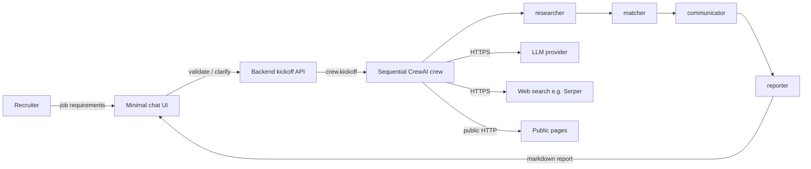

# Recruitment Assistant

Chat-operated copilot for **first-pass recruiting**: paste a job requisition, run a sequential multi-agent crew, and get a recruiter-facing shortlist with scores, source URLs, and outreach *drafts*. Humans decide and send; the system does not hire, reject, or message candidates.

The product follows [project-context/1.define/prd.md](project-context/1.define/prd.md). Runtime for the generated MVP is **CrewAI** (`AAMAD_TARGET_RUNTIME=crewai`). Planning uses the [AAMAD](https://pypi.org/project/aamad/) Define → Build → Deliver workflow.

**Status:** Define phase. Market research and the PRD are in `project-context/1.define/`. Application code (chat UI, crew, `.env.example`) is not scaffolded until Phase 2 (`@project.mgr` / `@backend.eng` / `@frontend.eng`).

---

## Table of contents

- [Overview](#overview)
- [Problem and value](#problem-and-value)
- [Key features](#key-features)
- [Architecture](#architecture)
- [Getting started](#getting-started)
- [Project structure](#project-structure)
- [What we will not ship](#what-we-will-not-ship)
- [Next steps for contributors](#next-steps-for-contributors)
- [Documentation](#documentation)

---

## Overview

Recruitment Assistant is an **assistive shortlist tool** for in-house or agency recruiters (and hiring managers who read the report) filling **professional/technical** roles. It is not an ATS, not a job board, and not a LinkedIn Recruiter replacement.

A recruiter submits structured job requirements (title, description, must-haves, optional location/remote, preferred qualifications, perks). The app checks for empty or vague reqs, then kicks off four CrewAI agents in order. The reporter compiles one markdown report: profiles, ranked scores with justifications, outreach templates, and sources.

**Trace:** workflow and YAML-first crew match the [CrewAI recruitment example](https://github.com/crewAIInc/crewAI-examples/tree/main/crews/recruitment), with a hard product rule: **no LinkedIn cookie / Selenium login** (the upstream example warns that path can violate LinkedIn’s terms).

---

## Problem and value

**Problem.** First-pass sourcing, scoring, and outreach copy still consume recruiter time. Informal ChatGPT chats are hard to audit. Full ATS products do not expose an inspectable research → score → draft → report pipeline. Calendar time-to-fill remains on the order of weeks (see the PRD / MRD for SHRM and related figures); this product targets **hours of first-pass work**, not the whole hiring process.

**Value proposition**

- Minutes-to-hours to a **reviewable shortlist** instead of a full day of Boolean search and first-touch writing.
- **≥ 3 hours/week** saved per *active* recruiter on sourcing + scoring + outreach drafting, and **≥ 2 hours/req** on that same first-pass work (PRD §7; operational diary metric, not a CI assertion).
- **Explainable** scores tied to the written req; every listed lead has a `source_url` or is marked `unverified`.
- **Recommend-only** language (“for recruiter review”), never “rejected by AI.”
- **ToS-safer sourcing:** public web search and public pages only.

---

## Key features

MVP (P0) as specified in the PRD:

| Feature | Behavior |
|---------|----------|
| Job requirement intake | Chat or pasted YAML/markdown blob → one `job_requirements` payload. Empty title does not kick off. |
| Clarify-before-kickoff | Empty must-haves block the run. Missing seniority/location or vague-only text (for example “good culture fit”) asks for detail or an allowed “run anyway.” |
| Sequential crew | Researcher → matcher → communicator → reporter; report task receives the three prior outputs as context. |
| Public candidate research | Up to **N=10** leads by default (5–10 configurable). No invented emails or phones. |
| Match and score | Ranked numeric scores and written justifications; no protected-class proxies. |
| Outreach drafts | Copy-ready templates; **not sent**. |
| Recruiter report | Markdown **without** wrapping code fences; copy/download; **Assumptions** section if the run used confirmed gaps. |
| Run status | In-progress, needs-clarification, error/Diagnostic, completed. Failures are not silently filled. |
| Secrets | Environment variables only (`OPENAI_API_KEY` or equivalent, `SERPER_API_KEY` or equivalent). No `LINKEDIN_COOKIE`. |
| Chat UI | Minimal, system theme; desktop-first. |

**P1 (not MVP):** adjustable N in the form, local report history, task streaming, PDF export.

**P2 / later:** official people-search APIs, ATS export, recruiter-OAuth send with confirm, SSO, bias-audit packs. Emotion/personality inference about candidates is **never** in scope.

---

## Architecture

### Runtime view



- **Process:** sequential; `allow_delegation=false`; `memory=false`.
- **Config:** `config/agents.yaml` and `config/tasks.yaml` (required by the CrewAI adapter).
- **Concurrency (MVP):** one active crew per process unless the SAD raises it.
- **Hosting (MVP):** local/dev, CPU, no GPU. Health endpoint and redacted logs after Build.

### Agents and roles

| Agent id | Role | Goal | Tools |
|----------|------|------|--------|
| `researcher` | Job Candidate Researcher | Find public-web candidates for the job | Web search, public scrape. **No** LinkedIn cookie/Selenium. |
| `matcher` | Candidate Matcher and Scorer | Score against the written req (plus recruiter-confirmed Assumptions only) | Search/scrape for evidence checks. |
| `communicator` | Candidate Outreach Strategist | Draft outreach methods and templates | Optional public scrape for company tone. **No** send-mail. |
| `reporter` | Candidate Reporting Specialist | Compile the recruiter report | None. Context = the three prior tasks. |

### Ambiguity (runtime)

Agents **do not invent a job spec**. Empty title or empty must-haves: no `crew.kickoff()`. Allowed gaps after “run anyway”: listed in the report **Assumptions**. Tool/LLM/guardrail failure: Diagnostic, halt or labeled partial results.

AAMAD *development* personas (Product Manager, Architect, engineers) follow the same idea in artifacts: **Assumptions**, **Open Questions**, Diagnostic halt — they do not silently expand PRD scope.

---

## Getting started

### Prerequisites

- Python **3.10+** (CrewAI requires `>=3.10` and `<3.14`).
- Git; an IDE with AAMAD personas (Cursor is the default layout in this repo).
- Accounts for an OpenAI-compatible LLM and a web search API (Serper or equivalent) **when you run the crew** — not required to edit Define docs.

### Clone and Python env

```bash
git clone <this-repository-url>
cd recruitment-assistant
python3 -m venv .venv
source .venv/bin/activate   # Windows: .venv\Scripts\activate
pip install aamad
```

Optional project config:

```bash
cp aamad.config.example.yml aamad.config.yml
```

Set the Phase 2 runtime before implementation work:

```bash
export AAMAD_TARGET_RUNTIME=crewai
```

### Environment variables (application — after Build)

Create `.env` from `.env.example` once backend scaffolding exists. Expected **names** (PRD AC-009):

| Variable | Purpose |
|----------|---------|
| `OPENAI_API_KEY` (or documented provider equivalent) | LLM |
| `SERPER_API_KEY` (or equivalent) | Web search |

Do **not** add `LINKEDIN_COOKIE`. Never commit secret values.

### Run the product

The chat UI and `crew.kickoff()` entrypoint are **not in the tree yet**. After Phase 2, follow `project-context/2.build/setup.md` and `project-context/3.deliver/user-guide.md` (when written). Until then, use the PRD as the source of truth for behavior.

### Validate AAMAD artifacts

```bash
aamad validate --phase define
```

Define currently expects `prd.md` **and** `sad.md`. `sad.md` is produced by `@system.arch`; validation will fail until that file exists.

---

## Project structure

```
recruitment-assistant/
├── AGENTS.md                      # AAMAD persona index
├── CHECKLIST.md                   # Define → Build → Deliver checklist
├── aamad.config.example.yml       # Copy to aamad.config.yml
├── project-context/
│   ├── 1.define/                  # MRD, PRD, context summary (SAD next)
│   ├── 2.build/                   # setup, FE/BE, integration, QA, security (later)
│   └── 3.deliver/                 # deploy runbook, user guide (later)
└── .cursor/
    ├── agents/                    # Persona contracts
    ├── rules/                     # Core + CrewAI adapter
    ├── templates/                 # PRD, SAD, …
    └── prompts/
```

**After Build**, expect application paths along the lines of:

- `config/agents.yaml`, `config/tasks.yaml`, crew entrypoint (Python)
- Backend API + minimal frontend
- `.env.example` without secret values

Exact package layout is owned by `@project.mgr` / SAD — do not treat the bullets above as frozen paths until `setup.md` exists.

---

## What we will not ship

- Authenticated LinkedIn scraping (`LI_AT`, Selenium login).
- Auto-send email or InMail.
- Auto-reject or “not qualified” notices to people.
- Durable shared candidate CRM in MVP.
- Claiming EU high-risk / NYC AEDT conformity in this cycle.

---

## Next steps for contributors

Work is persona-scoped. Prefer a **new chat** per epic (`CHECKLIST.md`). Do not implement application logic in Deliver. Do not invent requirements: record Assumptions and Open Questions.

1. **Architecture — `@system.arch`**  
   `*create-sad` (and SFS). Resolve PRD open questions that belong in SAD: model pin, `max_rpm` / timeouts, N default, vague-req heuristic, score rubric weights.

2. **Optional stories — `@product-mgr`**  
   `*create-stories` under `project-context/1.define/user-stories/` mapped to AC-001–AC-013.

3. **Setup — `@project.mgr`**  
   Scaffold Python env, CrewAI deps, `.env.example`, `setup.md`. Copy `aamad.config.yml` if the operator agrees.

4. **Backend — `@backend.eng`**  
   YAML crew, kickoff API, clarify-before-kickoff, no LinkedIn cookie tools, report contract.

5. **Frontend — `@frontend.eng`**  
   Minimal chat: empty / in-progress / needs-clarification / error / completed; recommend-only copy.

6. **Integration — `@integration.eng`**  
   Wire chat to kickoff; health; error shapes.

7. **QA — `@qa.eng`**  
   Unit + integration mapped to acceptance criteria. Hours/week time-saved is an **operator diary**, not a unit test.

8. **Security — `@security.eng`**  
   `security.md` before Deliver (`require_security_assessment: true` in the example config).

9. **Deliver — `@devops.eng`**  
   CI (lint/test/build only), `deploy.md`, user guide. No live deploy without explicit operator authorization.

10. **Product follow-ups**  
    Time-saved diary method (PRD Open Question 11); P1 streaming and report history after MVP verification.

---

## Documentation

| Artifact | Path |
|----------|------|
| PRD | [project-context/1.define/prd.md](project-context/1.define/prd.md) |
| MRD | [project-context/1.define/mrd.md](project-context/1.define/mrd.md) |
| Context summary | [project-context/1.define/context-summary.md](project-context/1.define/context-summary.md) |
| Execution checklist | [CHECKLIST.md](CHECKLIST.md) |
| Personas | [AGENTS.md](AGENTS.md) |

AAMAD framework files under `.cursor/` follow the [AAMAD](https://pypi.org/project/aamad/) Apache-2.0 distribution. Application copyright and license for generated MVP code will be recorded when the codebase is scaffolded.
