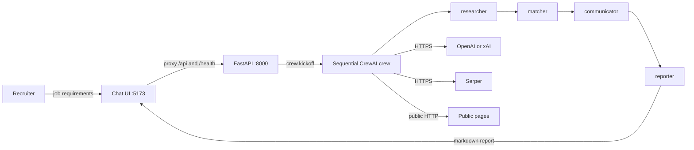

# Recruitment Assistant

Chat-operated copilot for **first-pass recruiting**: paste a job requisition, run a sequential multi-agent crew, and get a recruiter-facing shortlist with scores, source URLs, and outreach *drafts*. Humans decide and send; the system does not hire, reject, or message candidates.

The product follows [project-context/1.define/prd.md](project-context/1.define/prd.md). Runtime for the MVP is **CrewAI** (`AAMAD_TARGET_RUNTIME=crewai`). Planning uses the [AAMAD](https://pypi.org/project/aamad/) Define → Build → Deliver workflow.

**Status:** Build phase is complete. Define artifacts are in `project-context/1.define/`. Setup, frontend, backend, integration, and QA artifacts are in `project-context/2.build/`. The API is `src/backend/` and the chat UI is `src/frontend/`. Security assessment and Deliver (`deploy.md`, user guide) have not started.

---

## Table of contents

- [Overview](#overview)
- [Problem and value](#problem-and-value)
- [Key features](#key-features)
- [Architecture](#architecture)
- [Getting started](#getting-started)
- [Project structure](#project-structure)
- [What we will not ship](#what-we-will-not-ship)
- [Next steps for contributors](#next-steps-for-contributors)
- [Documentation](#documentation)

---

## Overview

Recruitment Assistant is an **assistive shortlist tool** for in-house or agency recruiters (and hiring managers who read the report) filling **professional/technical** roles. It is not an ATS, not a job board, and not a LinkedIn Recruiter replacement.

A recruiter submits structured job requirements (title, description, must-haves, optional location/remote, preferred qualifications, perks). The app checks for empty or vague reqs, then kicks off four CrewAI agents in order. The reporter compiles one markdown report: profiles, ranked scores with justifications, outreach templates, and sources.

**Trace:** workflow and YAML-first crew match the [CrewAI recruitment example](https://github.com/crewAIInc/crewAI-examples/tree/main/crews/recruitment), with a hard product rule: **no LinkedIn cookie / Selenium login** (the upstream example warns that path can violate LinkedIn’s terms).

---

## Problem and value

**Problem.** First-pass sourcing, scoring, and outreach copy still consume recruiter time. Informal ChatGPT chats are hard to audit. Full ATS products do not expose an inspectable research → score → draft → report pipeline. Calendar time-to-fill remains on the order of weeks (see the PRD / MRD for SHRM and related figures); this product targets **hours of first-pass work**, not the whole hiring process.

**Value proposition**

- Minutes-to-hours to a **reviewable shortlist** instead of a full day of Boolean search and first-touch writing.
- **≥ 3 hours/week** saved per *active* recruiter on sourcing + scoring + outreach drafting, and **≥ 2 hours/req** on that same first-pass work (PRD §7; operational diary metric, not a CI assertion).
- **Explainable** scores tied to the written req; every listed lead has a `source_url` or is marked `unverified`.
- **Recommend-only** language (“for recruiter review”), never “rejected by AI.”
- **ToS-safer sourcing:** public web search and public pages only.

---

## Key features

MVP (P0) as specified in the PRD:

| Feature | Behavior |
|---------|----------|
| Job requirement intake | Chat or pasted YAML/markdown blob → one `job_requirements` payload. Empty title does not kick off. |
| Clarify-before-kickoff | Empty must-haves block the run. Missing seniority/location or vague-only text (for example “good culture fit”) asks for detail or an allowed “run anyway.” |
| Sequential crew | Researcher → matcher → communicator → reporter; report task receives the three prior outputs as context. |
| Public candidate research | Up to **N=10** leads by default (5–10 configurable). No invented emails or phones. |
| Match and score | Ranked numeric scores and written justifications; no protected-class proxies. |
| Outreach drafts | Copy-ready templates; **not sent**. |
| Recruiter report | Markdown **without** wrapping code fences; copy/download; **Assumptions** section if the run used confirmed gaps. |
| Run status | In-progress, needs-clarification, error/Diagnostic, completed. Failures are not silently filled. |
| Secrets | Environment variables only. `LLM_PROVIDER` is `openai` (`OPENAI_API_KEY`) or `grok` (`XAI_API_KEY`). `SERPER_API_KEY` is always required. No `LINKEDIN_COOKIE`. |
| Chat UI | Minimal, system theme; desktop-first. |

**P1 (not MVP):** adjustable N in the form, local report history, task streaming, PDF export.

**P2 / later:** official people-search APIs, ATS export, recruiter-OAuth send with confirm, SSO, bias-audit packs. Emotion/personality inference about candidates is **never** in scope.

---

## Architecture

Local MVP: a Vite chat page and a FastAPI process. The page posts a requisition to the API. The API applies the clarify-before-kickoff gate, then runs one sequential CrewAI crew.



- **UI:** `src/frontend` (React 18, Vite). Dev server proxies `/api` and `/health` to `http://127.0.0.1:8000`.
- **API:** `src/backend/main.py`. `GET /health`, `POST /api/runs`, `GET /api/runs/{run_id}`. One run at a time. Loopback bind, no login.
- **Crew:** `src/backend/crew.py` with `src/backend/config/agents.yaml` and `src/backend/config/tasks.yaml`. Sequential process, `allow_delegation=false`, `memory=false`.
- **Provider:** `LLM_PROVIDER=openai` (default) or `grok`. Search is Serper. No database. Completed markdown may be written under `var/runs/`.
- **Hosting:** two local processes, CPU, no GPU. A single container or static `dist/` behind FastAPI is Deliver work.

### Agents and roles

| Agent id | Role | Goal | Tools |
|----------|------|------|--------|
| `researcher` | Job Candidate Researcher | Find public-web candidates for the job | Web search, public scrape. **No** LinkedIn cookie/Selenium. |
| `matcher` | Candidate Matcher and Scorer | Score against the written req (plus recruiter-confirmed Assumptions only) | Search/scrape for evidence checks. |
| `communicator` | Candidate Outreach Strategist | Draft outreach methods and templates | Optional public scrape for company tone. **No** send-mail. |
| `reporter` | Candidate Reporting Specialist | Compile the recruiter report | None. Context = the three prior tasks. |

### Ambiguity (runtime)

Agents **do not invent a job spec**. Empty title or empty must-haves: no `crew.kickoff()`. Allowed gaps after “run anyway”: listed in the report **Assumptions**. Tool/LLM/guardrail failure: Diagnostic, halt or labeled partial results.

AAMAD *development* personas (Product Manager, Architect, engineers) follow the same idea in artifacts: **Assumptions**, **Open Questions**, Diagnostic halt — they do not silently expand PRD scope.

---

## Getting started

### Prerequisites

- Python **3.10+** (CrewAI requires `>=3.10` and `<3.14`). This repo uses Python 3.12 in `.venv`.
- Node.js 18+ for the chat UI. On WSL, use the Linux Node. Windows `npm` cannot install into the WSL project path.
- An OpenAI or xAI key, and a Serper key, before you start a crew. Editing docs does not need those keys.

### Environment setup

From the repo root:

```bash
python3 -m venv .venv
.venv/bin/pip install -r requirements.txt
cp .env.example .env
cd src/frontend && npm install
```

Set the runtime in `.env` (already present in `.env.example`):

```bash
AAMAD_TARGET_RUNTIME=crewai
```

`crewai` is the only runtime this MVP implements. The API reads `.env` from the repo root. Fill the key for the provider you select, and set `SERPER_API_KEY`. Do **not** add `LINKEDIN_COOKIE`. Do not commit `.env`.

| Variable | Purpose |
|----------|---------|
| `AAMAD_TARGET_RUNTIME` | `crewai` |
| `LLM_PROVIDER` | `openai` (default) or `grok` |
| `OPENAI_API_KEY` | Required when `LLM_PROVIDER=openai`. Create it at [platform.openai.com/api-keys](https://platform.openai.com/api-keys) |
| `OPENAI_MODEL` | OpenAI model. Default `gpt-4o` |
| `XAI_API_KEY` | Required when `LLM_PROVIDER=grok`. Create it at [console.x.ai](https://console.x.ai/) (API Keys). `GROK_API_KEY` is an alias |
| `GROK_MODEL` | Grok model. Default `grok-4.7` |
| `SERPER_API_KEY` | Web search. Required to start a crew |
| `HOST` / `PORT` | API bind. Defaults `127.0.0.1` and `8000` |
| `CANDIDATE_LIMIT` | Default N when the request omits it. Default `10` (allowed range 5–10) |

Optional: `cp aamad.config.example.yml aamad.config.yml`. The project runs without that file. Example preferences apply.

### Run the application

Two processes, from the repo root. The API:

```bash
source .venv/bin/activate
python main.py
```

The chat page, in a second terminal:

```bash
cd src/frontend && npm run dev
```

Open `http://127.0.0.1:5173/`. The API listens on `http://127.0.0.1:8000`. Check it with `GET /health` (`{"status":"ok"}`). The Vite server proxies `/api` and `/health`, so leave `VITE_API_BASE` unset unless the page should call the API host directly.

### Tests and artifact check

```bash
cd src/backend && ../../.venv/bin/python -m pytest
cd src/frontend && npm test && npm run lint
.venv/bin/aamad validate --phase build
```

`aamad` is installed in `.venv`. Activate that environment, or call `.venv/bin/aamad`, so the shell can find it.

---

## Project structure

```
recruitment-assistant/
├── AGENTS.md                      # AAMAD persona index
├── CHECKLIST.md                   # Define → Build → Deliver checklist
├── aamad.config.example.yml       # Copy to aamad.config.yml
├── project-context/
│   ├── 1.define/                  # MRD, PRD, SAD
│   ├── 2.build/                   # setup, frontend, backend, integration, QA
│   └── 3.deliver/                 # deploy runbook and user guide (not started)
├── src/
│   ├── backend/                   # CrewAI crew, FastAPI, tests
│   └── frontend/                  # Vite chat UI
└── .cursor/
    ├── agents/                    # Persona contracts
    ├── rules/                     # Core + CrewAI adapter
    ├── templates/                 # PRD, SAD, …
    └── prompts/
```

- `src/backend/config/agents.yaml`, `src/backend/config/tasks.yaml`
- `src/backend/crew.py` and `src/backend/main.py`
- `src/frontend/` chat client
- `.env.example` at the repo root, without secret values

---

## What we will not ship

- Authenticated LinkedIn scraping (`LI_AT`, Selenium login).
- Auto-send email or InMail.
- Auto-reject or “not qualified” notices to people.
- Durable shared candidate CRM in MVP.
- Claiming EU high-risk / NYC AEDT conformity in this cycle.

---

## Next steps for contributors

Work is persona-scoped. Prefer a **new chat** per epic (`CHECKLIST.md`). Define and Build (setup, frontend, backend, integration, QA) are done. Do not invent requirements: record Assumptions and Open Questions.

1. **Security — `@security.eng`**  
   `security.md` before Deliver (`require_security_assessment: true` in the example config).

2. **Deliver — `@devops.eng`**  
   CI (lint/test/build only), `deploy.md`, user guide. No live deploy without explicit operator authorization. Do not implement application logic in Deliver.

3. **Product follow-ups**  
   Time-saved diary method (PRD Open Question 11). Hours/week time-saved is an operator diary, not a unit test. P1 streaming and report history stay out of MVP.

---

## Documentation

| Artifact | Path |
|----------|------|
| PRD | [project-context/1.define/prd.md](project-context/1.define/prd.md) |
| SAD | [project-context/1.define/sad.md](project-context/1.define/sad.md) |
| MRD | [project-context/1.define/mrd.md](project-context/1.define/mrd.md) |
| Setup | [project-context/2.build/setup.md](project-context/2.build/setup.md) |
| Backend | [project-context/2.build/backend.md](project-context/2.build/backend.md) |
| Frontend | [project-context/2.build/frontend.md](project-context/2.build/frontend.md) |
| Integration | [project-context/2.build/integration.md](project-context/2.build/integration.md) |
| QA | [project-context/2.build/qa.md](project-context/2.build/qa.md) |
| Execution checklist | [CHECKLIST.md](CHECKLIST.md) |
| Personas | [AGENTS.md](AGENTS.md) |

AAMAD framework files under `.cursor/` follow the [AAMAD](https://pypi.org/project/aamad/) Apache-2.0 distribution.
